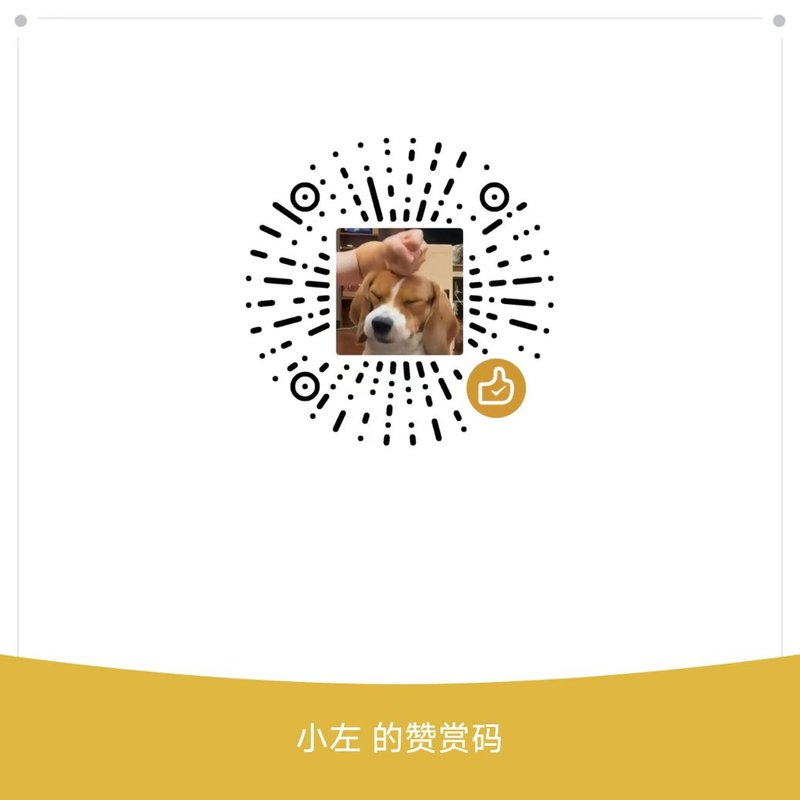

# 水衣管家

把校园里两台自助设备(直饮水机, 自助洗衣机)的操作, 收进同一个 Android 界面.
不用在四五个小程序之间来回切: 扫码, 看余额, 下单, 看出水进度, 查历史订单.

本软件是**第三方客户端**, 与任何平台运营方无隶属或合作关系. 完全开源免费, 仅供个人学习与技术交流, **不可商用**.

> 觉得有用? 可以[请我喝杯咖啡](#赞赏) -- 金额随意, 完全自愿, **不解锁任何功能**.

---

## 它做什么

| 取水 | 洗衣 |
| --- | --- |
| 扫码 / 手输设备码读机器 | 扫码 / 手输设备号读机器 |
| 多水区余额与通道占用 | 附近建筑 -> 楼内空闲机器 |
| 一键出水(按升计费) | 选程序 / 水温 / 洗衣液 / 除菌液 / 烘干 |
| 积分抵扣, 签到, 券包 | 下单 -> 支付宝付款 -> 看出水进度 |
| 订单与消费记录 | 历史订单(含已取消/超时) |

另外还有:

- **内置全屏闹钟**: 洗衣完成提醒走前台服务 + 全屏界面, 锁屏与后台都能响, 不依赖系统时钟 App.
- **占用状态自动刷新**: 取水通道与楼内机器各自定时重扫, 界面上的"空闲/使用中"会自己变.
- **一键备份与恢复**: 账号与设置在卸载重装后能读回来.
- **应用内更新**: 从项目发布页读版本号, 有新版才下载, 按 CPU 架构选包.
- **更新日志内置**: 设置页与更新页直接摊开这一版改了什么; 有新版时摊新版, 没有时摊当前版.
- **升级后首次提示**: 装上新版后第一次打开弹一次本次更新内容, 看过就不再弹.

## 它不做什么

- 不代收任何费用. 充值与支付都走原平台链路, 钱不经过本软件.
- 不改写服务端返回的数字. 余额, 单价, 订单金额一律照原样显示, 只做单位换算.
- 不做后台常驻, 不上传使用记录, 不集成任何第三方统计或广告 SDK.
- 不自更新, 不静默安装. 升级包由你手动确认后才交给系统安装器.

## 隐私

**本软件没有服务器, 不收集, 不上传任何个人信息.** 详细条款见应用内的 隐私政策 页(首次启动时完整展示, 也可在 设置 - 用户协议 里随时翻看). 要点:

- 登录凭证只存在本机 localStorage, 不上传.
- 定位只在你点"找洗衣机"时取一次, 用完即弃, 不落盘.
- 只会与 `userapi.qiekj.com`, `phoenix.ujing.online` 以及你的支付宝客户端通信.

## 版本与更新日志

当前版本见 `docs/version.json` 的 `version`. 发布流程是: 改版本号 -> 构建 -> 把 APK 覆盖到 `docs/` -> 更新 `docs/version.json` -> 打 tag 推上去.

`docs/version.json` 里的 `notes` 会被应用直接读出来展示, 数组或整段字符串都吃. 应用内还内置了一份 `CHANGELOG`(随包走, 断网也能翻); 远端读不到时回落内置那份.

| 版本 | 日期 | 要点 |
| --- | --- | --- |
| 1.1.1 | 2026-11-09 | 洗衣订单卡的操作按钮放大: 刷新状态 / 开启洗衣机 / 完成提醒 三个并排到和取消订单同一档, 主操作开启洗衣机双倍高度, 与取消订单之间留出间距 |
| 1.1.0 | 2026-11-09 | 自 1.0.3 起的累计改动: 闹钟改用系统时钟并按账单完成时刻自动登记, 开机补登记, 修剩余时长单位误判与终态不撤闹钟, 时间基准改从服务器 Date 头取, 闹钟自检三项; 扫码预览比例; 更新页进度条与两个跳转; 更新日志进软件并在升级后首启弹一次; 协议权限页与按机型下载; 移除硬编码测试号自动重登 |
| 1.0.3 | 2026-11-08 | 修复下载完成后因安装权限提示被静默丢弃, 点"下载并安装"没有任何反应 |
| 1.0.2 | 2026-11-07 | 多源版本检查(镜像优先), 按 CPU 架构选包 |
| 1.0.1 | 2026-11-07 | 内置全屏闹钟, 备份与恢复 |
| 1.0.0 | 2026-11-06 | 首个发布版 |

## 构建

没有 gradle, 一个 bash 脚本 + Android SDK 就够.

需要自备:

```bash
export ANDROID_BUILD_TOOLS=$ANDROID_HOME/build-tools/34.0.0
export ANDROID_PLATFORM=$ANDROID_HOME/platforms/android-34/android.jar
```

再把两个依赖放进 `libs/`(体积大, 不入库):

- `libs/alipay_x/` -- 解压支付宝 `alipaysdk.aar` 内的 `classes.jar` 得到的 class 目录
- `libs/zxing-core.jar` -- 二维码解码

然后:

```bash
KS_PASS=<你的签名口令> ./build.sh
# 产物: build/hz-water.apk
```

首次运行会生成 `keystore.jks` 并打印随机口令(若未设置 `KS_PASS`). **务必保存口令与 keystore**, 换了签名后续版本无法覆盖安装.

源码结构:

```
app/AndroidManifest.xml     清单
app/assets/index.html       全部界面与业务逻辑(单文件 HTML/JS)
app/assets/reward.jpg       赞赏码
app/res/                    图标与启动图
app/src/com/hz/water/       Android 壳: WebView 宿主, 扫码, 支付宝桥, 闹钟, 备份
build.sh                    构建脚本
```

`app/assets/index.html` 是主要工作面. 页面用 WebView 加载, 通过 `window.HzNative` 调原生能力(扫码, 支付宝, 设闹钟, 读写备份, 取设备信息等).

三个容易踩的坑(脚本里已处理):

1. `aapt2` 打不开含中文的绝对路径, 全程用相对路径.
2. `javac` 21 生成的匿名内部类(带 NestHost)会让 build-tools 34 的 D8 8.2.2 抛 NPE, 所以源码里禁用匿名内部类.
3. `d8` 的 `--output` 目录必须事先存在.

## 许可

本项目仅供个人学习与技术交流使用, **不可商用**.

- 你可以自由阅读, 编译, 修改, 分发.
- 分发时必须保留原作者署名, 许可全文与源码出处链接.
- 不得用于任何形式的营利: 出售, 出租, 付费下载, 捆绑销售, 随硬件搭售, 应用内广告/导流/抽成/代收款项.
- 不得以本软件提供代下单, 代充值, 代出水, 代洗衣等有偿或无偿服务.
- 衍生作品必须以相同条款开源, 不得改为闭源或私有许可.
- 修改版须显著标注"本作品基于原项目修改".

详见 [LICENSE](LICENSE).

## 免责

本软件按"现状"提供, 不作任何担保. 因使用本软件产生的任何直接或间接损失(包括但不限于误操作扣费, 衣物损坏, 余额损失, 数据丢失), 作者不承担责任.
本软件完全免费, 你支付的对价为 0 元, 故作者承担的全部责任上限为 0 元人民币.

接口地址, 参数与风控策略随时可能被对应平台调整, 功能失效时本软件会尽量如实显示错误, 但不承诺修复时限.

## 赞赏

如果你觉得这个软件省了你的时间, 可以请我喝杯咖啡. 金额随意, **完全自愿**.

<p align="center">
  
  <br>
  <sub>微信 / 支付宝 扫一扫</sub>
</p>

微信或支付宝直接扫上面的码就行, 也可以在同一份源码里的 `app/assets/reward.jpg` 找到原图, 或在应用内 设置 - 赞赏 打开同一张码.

关于赞赏的三条边界, 写清楚比不说好:

- **赞赏不解锁任何功能**. 不赞赏, 全部功能一样能用. 没有会员, 没有内购, 没有试用期, 没有"捐助版"分支.
- **赞赏不是购买**. 本项目依 [LICENSE](LICENSE) 不可商用; 赞赏仅是对作者投入时间的自愿赠与, 不构成购买, 订阅, 或任何服务承诺, 也不产生退款与售后关系.
- **赞赏不换取技术支持优先权**. 问题与建议请走 Issues, 处理顺序只看问题本身, 与是否赞赏无关.

把码放在仓库里而不是只放在软件内, 是因为很多人**下载之前**就想知道自己能不能支持一下, 也让"这个项目靠什么维持"在仓库里就是公开的.
